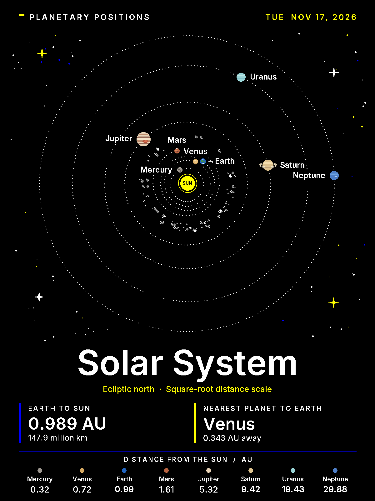

# Solar System Dashboard

A daily 1200 × 1600 dashboard for E Ink Spectra 6 displays such as the Seeed E1004. It shares the black background, six-color accents, and bundled Inter fonts of the [Moon Phase Dashboard](https://github.com/MostlyFunctionalEngineering/moon_phase_dashboard). The planet icons use natural RGB colors for the display to dither.

<a href="assets/dashboard-preview.png"></a>

The map looks down from ecliptic north. The planet positions and orbit guides use a square-root distance scale to keep the inner solar system readable. Planet sizes are illustrative. The dithered asteroid belt represents the main belt between 2.2 and 3.2 AU. The dashboard shows the local date, Earth’s distance from the Sun, the planet currently closest to Earth, and each planet’s distance from the Sun in astronomical units (AU).

Planet positions are computed locally from [NASA/JPL’s approximate planetary elements](https://ssd.jpl.nasa.gov/planets/approx_pos.html) for 1800–2050. The Earth marker uses the Earth–Moon barycenter. No astronomy API or credentials are required at render time.

Set `SHOW_MOONS=1` to draw white dots for eight major moons. Each dot follows the moon’s calculated direction from its planet, with enlarged offsets for readability. [Astronomy Engine](https://github.com/cosinekitty/astronomy) supplies Earth’s Moon, Io, Europa, Ganymede, and Callisto. Titan, Titania, and Triton use approximate models fitted to [JPL Horizons](https://ssd.jpl.nasa.gov/horizons/) vectors for 2025–2028. Their accuracy decreases for dates farther from that interval.

## GitHub Pages

Select **GitHub Actions** under **Settings → Pages → Build and deployment**, then run **Update Solar System Dashboard** from the Actions tab. The scheduled workflow runs daily at 08:15 UTC, matching the Moon Phase Dashboard.

Point your display at `https://<owner>.github.io/<repository>/solar_dashboard.png`. The site root shows the image in a browser, and `solar_data.json` contains the UTC timestamp, local date, heliocentric coordinates, distances, and planet-centered moon offsets in kilometers.

The workflow accepts these optional repository variables under **Settings → Secrets and variables → Actions → Variables**.

| Variable | Default | Purpose |
| --- | --- | --- |
| `TZ_NAME` | `America/Los_Angeles` | IANA time zone for the date shown on the dashboard |
| `ROTATE` | `0` | Clockwise rotation in degrees. Supports `0`, `90`, `180`, and `270`. |
| `OUTPUT_PALETTE` | `pure` | Use `device` for measured panel colors on the text, background, and accents. Planet icons use RGB in both modes. |
| `SHOW_MOONS` | `0` | Set to `1` to show the moon dots. Moon positions are always included in the JSON. |

## Run locally

Use Python 3.12, the same version as the workflow.

```sh
python -m pip install -r requirements.txt
python scripts/render_solar.py
```

The renderer writes `output/solar_dashboard.png` and `output/solar_data.json`. Set `OUTPUT_DIR` to change the destination or `SOLAR_NOW` to render a specific ISO 8601 timestamp such as `2026-11-17T08:15:00Z`. If the timestamp omits an offset, the renderer uses UTC.

The bundled Inter fonts are distributed under the [SIL Open Font License](assets/fonts/LICENSE-Inter.txt).
